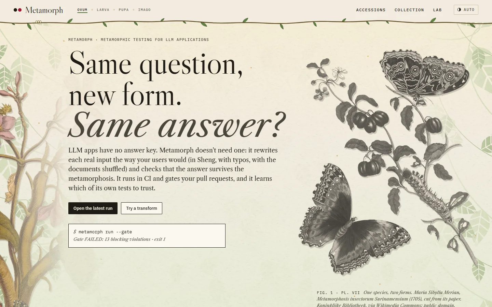
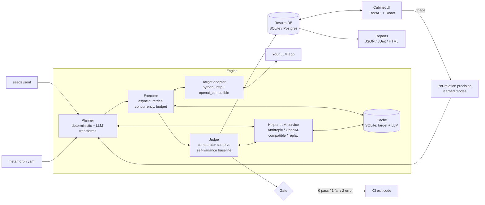
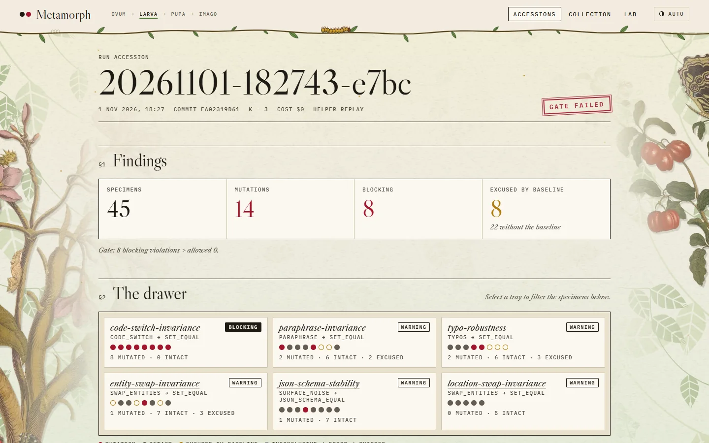
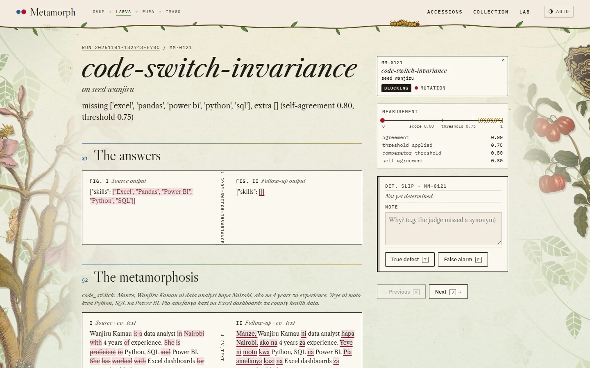
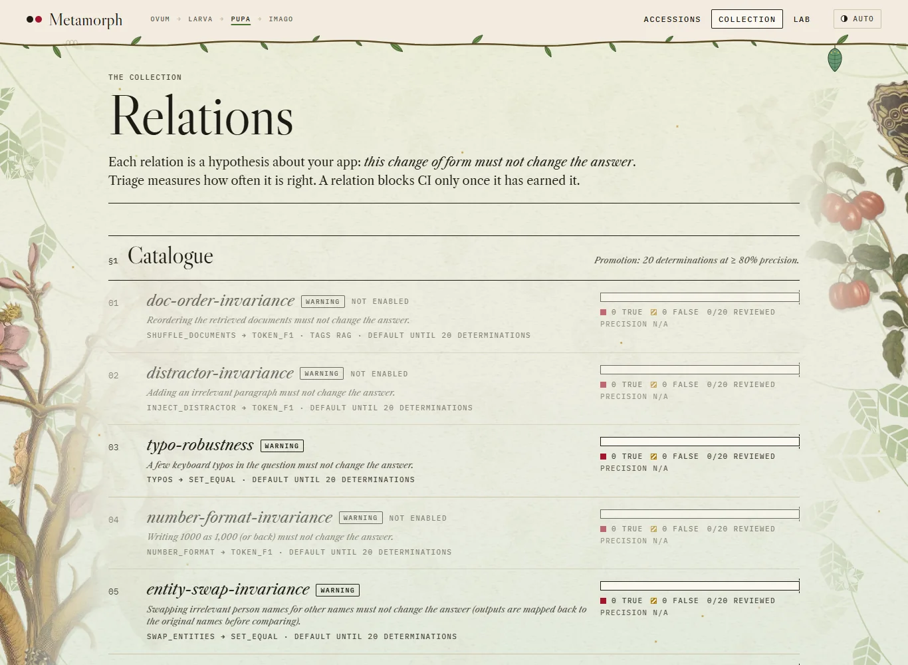
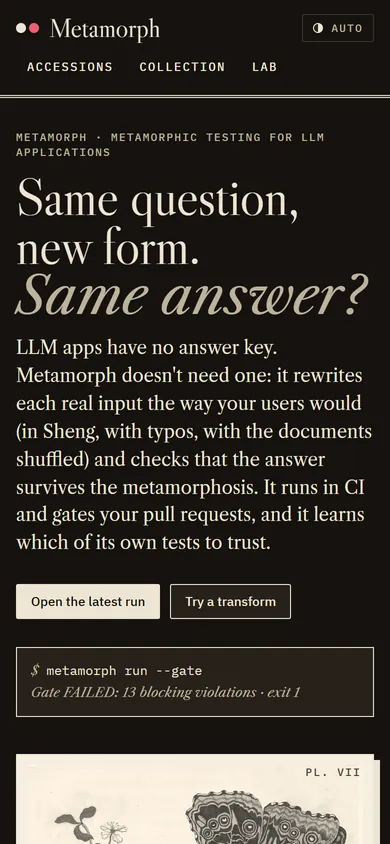

# Metamorph

**Test an LLM application without a single labelled answer, and gate CI on the result.**

[](https://github.com/DiorWachira/metamorph/actions/workflows/ci.yml)

LLM apps are hard to test because there is no oracle: for most inputs nobody has written down
the correct output. *Metamorphic testing* sidesteps that. You may not know the right answer to
a question, but you do know that reordering the retrieved documents, adding an irrelevant
paragraph or making a typo should not change it. Metamorph generates those follow-up inputs,
calls your app as a black box, checks the *relation* between the outputs, and exits non-zero in
CI when a blocking relation is violated.

What sets it apart:

- **App-level and CI-native.** It tests your deployed endpoint or Python function, not a raw
  model, and gates pull requests with exit codes.
- **It attacks false alarms.** A self-variance baseline means a follow-up fails only if it
  disagrees with the source more than the app disagrees with itself. On a noisy target it cut
  false alarms by 81% ([measured below](#the-self-variance-baseline-measured)). Then it
  learns precision per relation from your triage, and only relations that earn it may block
  CI.
- **Relations for Kenyan products**: English / Kiswahili / Sheng code-switch invariance and a
  Kiswahili translation round trip, alongside 10 other built-in relations.
- **It writes app-specific tests from your requirements.** The relation miner turns a SPEC or
  system prompt into executable relations, each quoting the requirement it came from, for
  you to approve.
- **Cheap to run.** Target responses and helper-LLM calls are cached on disk, a cost budget
  stops a run gracefully, and recorded LLM calls replay in CI with no API key.

> **Status:** milestones 1–4 of 5 are done (core engine; LLM relations and self-variance
> baseline; triage UI and learned promotion; relation miner and GitHub Action). M5 is under way:
> the [first case study](#case-study-repolenss-offline-examiner) is published, and the run against
> a live LLM still needs an API key. See the [roadmap](#roadmap).



## 60-second quickstart

```bash
git clone https://github.com/DiorWachira/metamorph && cd metamorph
python -m venv .venv && source .venv/bin/activate      # Windows: .venv\Scripts\activate
pip install -e ".[examples,server]"

cd examples/rag_kenya
metamorph run --gate          # exits 1: the planted bug is caught
RAG_FIXED=1 metamorph run --gate --no-cache    # exits 0 (PowerShell: $env:RAG_FIXED=1)
```

```
Run 20261101-163029-633b  calls: 63 requested, 0 cached, 0 failed  cost: $0.0000
| relation                 | mode     | cases | pass | violations | inconclusive | errors |
| doc-order-invariance     | BLOCKING | 15    | 2    | 13         | 0            | 0      |
| distractor-invariance    | warning  | 15    | 12   | 3          | 0            | 0      |
| typo-robustness          | warning  | 15    | 15   | 0          | 0            | 0      |
| number-format-invariance | warning  | 1     | 1    | 0          | 0            | 0      |
| entity-swap-invariance   | warning  | 2     | 2    | 0          | 0            | 0      |
x doc-order-invariance seed=constitution-date: token F1 0.17
    documents reordered to [2, 0, 1]
...
Gate FAILED: 13 blocking violations > allowed 0
```

A second demo extracts skills from CVs, like JobBridge. Its prompt only recognises skills after
English cue phrases, so CVs written in Sheng lose their skills:

```bash
cd ../cv_skills
metamorph run --gate          # exits 1: code-switch-invariance catches all 8 CVs
CV_FIXED=1 metamorph run --gate --no-cache    # exits 0
```

The first demo is a small RAG app over public facts about Kenya. Its generator reads only the
**first** retrieved chunk. Every example-based test passes, because retrieval usually ranks the
right chunk first. Shuffling the same chunks changes the answer, and `doc-order-invariance`
catches the bug without anyone labelling a single answer. Run it again and all 63 calls come
from the cache at zero cost, with identical verdicts.

Then open the cabinet, the triage UI, on either demo:

```bash
metamorph triage              # serves http://127.0.0.1:8765 and opens the latest run
```

To start on your own app:

```bash
metamorph init           # writes metamorph.yaml, seeds.jsonl and a placeholder app.py
metamorph run --gate
```

## How it works



1. **Plan.** For every seed and every applicable relation, the transform produces a follow-up
   input. Each transform's RNG is seeded from `(run seed, relation, seed, variant)`, so a
   re-run reproduces identical follow-ups and every call hits the cache.
2. **Call.** Unique `(input, sample)` pairs are collected first. Source outputs are shared
   across relations, so each source is called only once. The calls then run concurrently,
   with retries and exponential backoff on timeouts, 429 and 5xx.
3. **Judge.** A comparator scores agreement between the source and follow-up outputs from 0 to
   1. An invariance relation is violated when:

   ```
   best_score  <  min(threshold, self_agreement − margin)
   ```

   where `self_agreement` is the lowest agreement among `k` samples of the *same* source input
   (`run.samples`). A stable app is held to the threshold. An app that is noisy on its own is
   not blamed for that noise. With `samples: 1` the threshold applies on its own.
4. **Gate.** Only **blocking** violations count. A high target error rate is reported as a
   runtime error (exit 2), not as a pass.

### The self-variance baseline, measured

The CV extractor in `examples/cv_skills` is noisy like an LLM sampled at temperature > 0: the
same CV sometimes loses a skill or gains a related one. Because the target is simulated, the
ground truth is known: a reported violation is a *true bug* when the noise-free extractor
really answers the two inputs differently, and a *false alarm* when the difference is only
sampling noise. `python examples/cv_skills/measure.py` runs the suite over 5 run seeds:

| 200 cases | k = 1 (naive) | k = 3 (self-variance baseline) |
|---|---:|---:|
| violations reported | 127 | 69 |
| true bugs among them | 69 | 58 |
| false alarms | 58 | **11** (−81%) |
| precision | 54% | **84%** |
| recall of real bugs | 100% | 84% |

The naive precision of 54% is close to the ~60% true-positive rate reported for LLMORPH's
violations (Cho et al., 2025). The baseline is not free: when the app is noisy on an input, a
real bug that hides inside that noise is excused too, so recall drops from 100% to 84%. The
report lists those inputs as *unstable specimens*, so you know where your tests are weak.

### Triage and learned trust

A metamorphic test can be wrong: the judge can misread a synonym, or a "harmless" typo can hit a
name. So Metamorph measures each relation's precision from your own triage:

```
precision = true defects / (true defects + false alarms)        over every triaged violation
```

Every relation starts as **WARNING**. Once it has **20 determinations at ≥ 80% precision** it
is promoted to **BLOCKING**, and below 80% it is demoted again. A `mode:` pinned in
`metamorph.yaml` always wins over the learned mode. `metamorph relations stats` prints the
ledger; the UI's *Collection* page shows each relation's progress towards promotion.

### Exit codes

| code | meaning |
|---|---|
| 0 | gate passed (or `--gate` not given) |
| 1 | blocking violations exceed `gate.max_blocking_violations` / `max_blocking_rate` |
| 2 | config error, runtime crash, or target error rate above `gate.max_error_rate` |

## Configuration

```yaml
target:
  type: http                       # or: python (callable: "module:function")
  url: http://127.0.0.1:8000/answer
  output_path: $.answer            # JSONPath to the answer; omit to use the whole body
  headers: {Authorization: "Bearer ${APP_TOKEN}"}   # ${VAR} comes from the environment

seeds: seeds.jsonl                 # {"id": "...", "tags": ["rag"], "input": {...}} per line

fields:                            # where transforms find things in your input (dotted paths)
  text: question
  documents: documents             # list of strings or objects ({text: ...}); for RAG relations

relations:
  - typo-robustness                # built-in, default settings (WARNING)
  - id: doc-order-invariance       # built-in with overrides
    mode: blocking
    comparator: {name: token_f1, threshold: 0.9}
  - id: totals-stable              # fully custom
    description: Reformatting numbers must not change the computed total.
    transform: {name: number_format}
    comparator: {name: numeric_within, params: {path: "$.total", tol: 0.01}}

run:
  seed: 0            # reproducible follow-ups
  samples: 1         # k source samples for the self-variance baseline
  margin: 0.05
  concurrency: 8
  retries: 3

gate:
  max_blocking_violations: 0
  max_error_rate: 0.1

cache:
  enabled: true
  invalidate_on_code_change: true  # cache keys include git HEAD + working-tree diff

llm:                               # helper model for LLM transforms and the entails judge
  provider: anthropic              # or openai_compatible (OpenAI, Ollama, Groq...) or replay
  model: claude-opus-5-5           # any model; claude-haiku-5-5 is the cheap option
  effort: low                      # rewrites and judgements need little reasoning
  # record_to: recordings.jsonl    # save every call, then replay with provider: replay
```

`run.budget_usd` (or `--budget-usd`) caps the spend of a run across target and helper-LLM
calls. Before each paid call the budget is checked; once spent, nothing new starts, in-flight
calls finish, and unrun cases are reported as *skipped* (never as errors).

**Helper LLMs.** Anthropic calls use the official SDK (`pip install "metamorph[llm]"`) with
structured output, low effort and server-side refusal fallback. Every call is cached by
(purpose, model, request), so re-runs reproduce identical follow-ups for free. With
`record_to`, calls are appended to a JSONL file that `provider: replay` serves later; the CV
demo runs in CI this way. Its recordings are follow-ups I authored offline (no API key was
available while building it), and `rewrites.json` labels them as such.

Secrets are expanded from the environment at load time. Run snapshots in the database store
the config *as written*, so expanded secrets are never saved.

**RAG apps** need a way to accept context in the request (here, `documents`), so that
Metamorph can reorder it or add a distractor. The demo's `/answer` endpoint retrieves when
`documents` is absent and uses the given context when it is present.

## Relation catalogue

| id | transform | comparator | checks that… |
|---|---|---|---|
| `doc-order-invariance` | `shuffle_documents` | `token_f1 ≥ 0.8` | reordering retrieved docs keeps the answer (RAG) |
| `distractor-invariance` | `inject_distractor` | `token_f1 ≥ 0.8` | an irrelevant paragraph does not change the answer |
| `typo-robustness` | `typos` (rate 0.1) | `token_f1 ≥ 0.8` | keyboard typos in the question do not change the answer |
| `number-format-invariance` | `number_format` | `token_f1 ≥ 0.8` | `1000` ↔ `1,000` does not change the answer |
| `entity-swap-invariance` | `swap_entities` | `token_f1 ≥ 0.8` | swapping irrelevant names (mapped back before comparing) keeps the answer |
| `json-schema-stability` | `surface_noise` | `json_schema_equal` | formatting noise keeps a JSON output's keys and types |

| `paraphrase-invariance` | `paraphrase` (LLM) | `entails` | different wording keeps the answer |
| `translation-roundtrip-sw` | `translate` to Kiswahili and back (LLM) | `entails` | translation noise keeps the answer |
| `code-switch-invariance` | `code_switch` Sheng (LLM) | `entails` | English / Kiswahili / Sheng code-switching keeps the answer |
| `politeness-invariance` | `formality` polite (LLM) | `entails` | a politer request gets the same answer |
| `negation-flip` | `negate` (LLM) | `verdict`, expected **flips** | negating a yes/no question flips the answer (tag `yesno`) |
| `refusal-consistency` | `rephrase_request` (LLM) | `refusal_match` | rephrasing a harmful request cannot flip a refusal into compliance (tag `safety`) |

**Transforms:** `shuffle_documents`, `inject_distractor(position)`, `typos(rate)`,
`number_format(style, scope, skip_years)`, `swap_entities(categories)`, `surface_noise(ops)`;
LLM-backed: `paraphrase`, `translate(language, roundtrip)`, `code_switch(style)`,
`formality(direction)`, `negate`, `rephrase_request`.

**Comparators:** `exact`, `token_f1`, `numeric_within(tol, relative, path)`,
`json_fields_equal(paths)`, `set_equal(path)`, `json_schema_equal`,
`embedding_similarity(model)` (local multilingual MiniLM via fastembed, ONNX, no torch:
`pip install "metamorph[embeddings]"`), `entails` (LLM judge: ENTAILS 1.0 / NEUTRAL 0.5 /
CONTRADICTS 0.0 with a one-line reason), `verdict(labels, path)`, `refusal_match`. Each one
returns a score from 0 to 1, which is what makes the self-variance baseline possible.

Some care went into avoiding false alarms. Typos never touch numbers or words shorter than
four letters, because a typo in "not" or "2019" changes the meaning, not the spelling. Number
formatting leaves years, phone numbers and IDs alone. Entity swaps only replace whole words
from a Kenyan name bank, apply consistently across the question and the documents, and map
the names back in the outputs before comparing.

## The relation miner

The 12 built-in relations are generic. The bugs that matter are usually specific to your app,
and they are described in your requirements. `metamorph mine` turns those requirements into
relations, following Shin et al.'s approach of deriving executable metamorphic relations from
requirements with an LLM ([QUATIC 2024, arXiv:2401.17019](https://arxiv.org/abs/2401.17019)):

1. The helper model finds the sentences that constrain inputs and outputs, then turns each
   into a relation. Every proposal quotes its requirement.
2. Proposals must use Metamorph's own vocabulary. The output schema enumerates the registered
   transforms and comparators, so every proposal is executable by construction. App-specific
   changes use the `rewrite(instruction)` transform.
3. Each proposal is validated by actually building it. One with a misspelt parameter or a
   clashing id is dropped, and the reason is shown.
4. Nothing runs until a human approves. Approved relations go to `relations/custom.yaml`,
   which you commit, and they are enabled automatically.

```bash
cd examples/cv_skills
metamorph mine SPEC.md --hint "Extracts skills from CVs for a Kenyan job-matching service."
#  5 proposals written to relations/proposed.yaml
#  dropped years-are-not-skills: bad params for comparator 'numeric_within': ... 'tolerance'
metamorph relations proposals          # or review them on the cabinet's Collection page
metamorph relations approve location-swap-invariance
metamorph run                          # the approved relation now runs with the rest
```

From the CV demo's `SPEC.md`, the miner proposes the following:
- **location swap:** moving the candidate to another town must not change their skills;
- **sentence order:** reversing the order of the sentences must not change the skills;
- **gender swap:** changing the candidate's pronouns must not change the skills;
- **skill removal:** deleting a skill must change the output, an expected **flip**;
- **Kiswahili CV:** the same CV written in Kiswahili must yield the same skills.

All five are app-specific tests that no generic catalogue contains. (The demo's mining
response is authored and replayed, like its other LLM calls; with `llm.provider: anthropic` it
is generated live.)

**Learned trust travels with the repo.** Each triage verdict also updates
`relations/learned.yaml`. Commit it, and CI, which starts with an empty database, applies the
modes your relations have earned. `metamorph relations stats --export` writes the same file
from the command line.

## The GitHub Action

```yaml
# .github/workflows/metamorph.yml
on: pull_request
permissions: {contents: read, pull-requests: write}
jobs:
  metamorph:
    runs-on: ubuntu-24.04
    steps:
      - uses: actions/checkout@v7
      - uses: DiorWachira/metamorph@main
        with:
          config: metamorph.yaml
          extras: llm               # if your relations use a helper model
          budget-usd: "2.00"
        env:
          ANTHROPIC_API_KEY: ${{ secrets.ANTHROPIC_API_KEY }}
```

On every pull request the action:
1. Restores the response cache, so helper-LLM follow-ups and judgements are paid for once.
2. Runs the relations with `--gate`.
3. Writes a Markdown summary to the job page and uploads the JSON, JUnit and HTML reports.
4. Posts **one** PR comment and updates it in place on later pushes, so the thread isn't
   spammed. The comment carries the verdict, a row per relation and the first violations
   with both answers.
5. Applies the gate last, so the reports are always published even when it fails.

Exit code 2 (config or target failure) always fails the job. `fail-on-gate: "false"` reports
violations without blocking. This repository dogfoods the action on the CV demo in
[`.github/workflows/metamorph.yml`](.github/workflows/metamorph.yml).

## The cabinet (triage UI)

`metamorph serve` (or `metamorph triage`) starts a local FastAPI server with a React UI built
into the package, so no Node is needed to run it. It binds to 127.0.0.1 and has no auth, by
design: a single-user, local tool.

| | |
|---|---|
|  |  |
| **Accession (run):** findings, the drawer (one tray per relation, one pin per case), each specimen with its caliper, and the unstable inputs. | **Specimen (case):** the answers and inputs as word-diffed plates, the k source samples, the measurement, and the determination slip. Keys: `T` true defect, `F` false alarm, `U` clear, `J`/`K` next/previous. |
|  |  |
| **Collection:** each relation's precision meter, showing true defects and false alarms against the 20-review goal, and where its mode came from. | Light ("paper") and dark ("cabinet") themes; works at phone width. A **Lab** page previews any deterministic transform on your own text. |

**Design: the Specimen Cabinet.** The UI and HTML report treat a test suite as a
natural-history collection, because that is what metamorphic testing resembles: one specimen,
drawn in different forms, should still be the same species. References:

- **Maria Sibylla Merian, *Metamorphosis insectorum Surinamensium* (1705).** Each plate shows
  one creature as caterpillar and butterfly together. Plate VII is the hero image, cut from its
  paper: it arrives as a bare engraving and the colour floods in.
- **Herbarium determination slips.** Re-identifications are added on dated slips and never
  written over the label ([ANBG](https://www.anbg.gov.au/cpbr/herbarium/specimen/about_determination.html)).
  Triage verdicts are recorded the same way.
- **Entomology drawers and unit trays.** A run is a drawer, each relation is a tray, and each
  case is a pin.

**The site stands in its host plant.** Merian never drew an insect without the plant it feeds
on, so neither does this UI. Behind every page are her specimens, cut from the plates, and two
blocks of foliage printed the way
[Morris & Co. printed wallpaper](https://www.vam.ac.uk/articles/william-morris-and-wallpaper-design);
the page ends standing in grass. The header's rule is a twig, and the scroll position is a
caterpillar on it: it inches along only while you scroll, spins a chrysalis, and at the end of
the page (or on the later pages of the cabinet) leaves an empty shell. The butterfly then follows
your mouse and settles on whatever you are looking at, its wings shifting from blue to violet with
the angle, as a real Morpho's do. All of it is decorative: green is the plant and never a status,
carmine still means a mutation, and with reduced motion everything holds still. The artwork is
generated by `ui/scripts/make_habitat.py`.

**The cabinet is hand-coloured as you use it.** Merian's plates were printed as engravings and
coloured by hand afterwards, and the UI works the same way. At rest it is ink on paper. When
you move, scroll or type, her pigments (Morpho blue, leaf green and ochre) seep into the
headings, rules, trays and buttons, and a soft lamp follows the cursor. Hovering a plate makes
colour bloom outward from the cursor until the whole plate is coloured. After a moment of
stillness everything drains back to the engraving. Reduced-motion users get the colour with no
movement, and a tap colours a plate on touch screens.

The palette is rag paper and iron-gall ink, plus one signal colour: cochineal carmine, an
insect pigment reserved for mutations (violations). The hand-colouring pigments are decoration
that responds to you; they never carry a status. The type is Libre Caslon (display and
text) with IBM Plex Sans and Mono, all self-hosted. The meter colours (carmine against
hatched ochre) pass a colour-vision-deficiency validator in both themes. All tokens live in
`src/metamorph/design/specimen.css`, which the HTML report inlines and the UI imports. The
plates are public domain, from the Koninklijke Bibliotheek and the Biodiversity Heritage
Library via Wikimedia Commons.

## CLI

```
metamorph init [DIR]
metamorph run [--config F] [--relations a,b] [--limit N] [--gate] [--no-cache] [--budget-usd X]
metamorph report [RUN_ID|latest] [--format json|junit|html|markdown] [--out F]
metamorph serve [--port 8765] [--open]      # the cabinet UI + JSON API (/api/docs)
metamorph triage                            # serve and open the latest run
metamorph relations list | stats [--export]
metamorph mine SPEC.md [--hint "..."] [--limit 8]   # propose app-specific relations
metamorph relations proposals | approve ID... | reject ID...   (--all for every pending one)
```

Each run writes `report.json`, `junit.xml` and `report.html` to
`.metamorph/reports/<run-id>/`. In JUnit, only blocking violations are `<failure>`s, so a CI
test reporter turns red exactly when the gate fails. The HTML report is one static page with:
- findings, including the violations the baseline excused;
- a drawer of relations;
- each violation as a side-by-side plate with a word diff, and a caliper showing score against
  threshold and noise floor;
- the unstable inputs.

## Case study: RepoLens's offline Examiner

[RepoLens](https://github.com/DiorWachira/repolens) examines a repository and offers an Examiner to
ask about the result. This study tests its **offline mode**, the deterministic keyword router its
site ships, by running the real browser code at commit `8955383`. It is **not an LLM test**: the
Gemini mode is not covered yet, and neither is any live model. Follow-ups are hand-written replays.

| | |
|---|---|
| Inputs | 30: 10 questions (the Examiner's own prompts and plain ones) × 3 real examinations |
| Cases | 120 across 4 relations |
| Violations | 22 |
| Provisional precision | 4 of 22 true defects (18%), so an **82% false-alarm rate** on this target |
| Cost and time | $0 (no LLM calls), 11 seconds |

| Relation | Cases | Violations | True defects | False alarms |
|---|---:|---:|---:|---:|
| `typo-robustness` | 30 | 4 | 4 | 0 |
| `paraphrase-invariance` | 30 | 15 | 0 | 15 |
| `code-switch-invariance` | 30 | 3 | 0 | 3 |
| `politeness-invariance` | 30 | 0 | 0 | 0 |

**The defect it found:** one misspelled letter drops a documented question to the fallback answer.
"Build a fix pkan for the whole report" and "What should I fix fiirst, and why?" get a general
summary instead of the plan or the first fix. The severity is low, because the fallback explains
what to ask instead.

**Why so many false alarms:** the offline mode says it handles a plan, what to fix first and
explaining a line, and sends free-form questions to Gemini. Rewordings like "What matters most for
me to work on now?" really do get a different answer, but that is the documented scope and not a
bug. This is the case for starting every relation as a warning: the free-form relations were the
wrong test for a keyword router, and triage shows that.

**How far to trust these numbers:**

- The determinations are the author's, made by one written rule in
  [`apply_triage.py`](examples/repolens_examiner/apply_triage.py), not by an independent reviewer.
- The 22 violations are not independent. The same wordings recur across three reports, so they
  come from 10 distinct follow-up questions.
- No relation reached the 20 reviews that learned promotion needs, so promotion is **not yet shown
  on real data**. The study did not pad its inputs to get there.
- The self-variance baseline does not apply, because this target is deterministic.

To reproduce it, see [`examples/repolens_examiner/metamorph.yaml`](examples/repolens_examiner/metamorph.yaml).

## Project layout

```
src/metamorph/
  cli.py  config.py  seeds.py  suite.py  gate.py  types.py
  adapters/      python and http targets
  transforms/    deterministic follow-up generators (+ registry)
  comparators/   agreement scorers (+ registry)
  relations/     builtin.yaml catalogue and resolver
  runner/        cache, executor (retries, concurrency), judge, engine
  storage/       SQLAlchemy Core schema (portable to Postgres) and repository
  reports/       report model, JSON and JUnit renderers
  data/          distractor bank, Kenyan entity bank
  llm/           helper-LLM providers (Anthropic SDK, OpenAI-compatible, replay) + service
  design/        specimen.css, the design system shared by the HTML report and the UI
  server/        FastAPI triage API; static/ holds the built UI
  promotion.py   precision and learned modes
  miner.py       relation miner: requirements -> validated proposals
  collection.py  relations/proposed.yaml, custom.yaml and learned.yaml
action.yml            the GitHub Action (composite)
ui/                   React + Vite + TypeScript source of the cabinet
examples/rag_kenya/   demo RAG app with a planted bug (doc order)
examples/cv_skills/   noisy skill extractor with a planted bug (code-switching) + measure.py
examples/repolens_examiner/   case study on RepoLens's real offline Examiner
tests/                unit, Hypothesis property, runner (scripted fake target), end-to-end
```

## Development

```bash
pip install -e ".[dev]"
pytest -q                 # unit, property, runner and e2e tests, with no network or API keys
ruff check src tests examples && ruff format --check src tests examples
mypy

cd ui && npm ci
npm run dev               # hot-reloading UI on :5173, proxying /api to `metamorph serve`
npm test && npm run build # builds into src/metamorph/server/static
```

## Roadmap

- [x] **M1 Core engine:** types, 6 deterministic relations, python and http adapters,
      async runner, response cache, SQLite storage, JSON and JUnit reports, CLI and gate exit codes
- [x] **M2** LLM transforms (paraphrase, Kiswahili, Sheng code-switching) and comparators
      (embeddings, LLM entailment judge), the self-variance report section, cost budget,
      record/replay, openai_compatible target, HTML report
- [x] **M3** Triage UI (the cabinet), per-relation precision, learned promotion and demotion
- [x] **M4** Relation miner (requirements to proposals to human approval to `custom.yaml`),
      learned modes committed with the repo, and a GitHub Action with a sticky PR comment
- [ ] **M5** Case study: violations found, false-alarm rate and cost per run
  - [x] RepoLens's offline Examiner, with published results
  - [ ] RepoLens's Gemini Examiner and real recorded helper-model calls (needs an API key)
  - [ ] Learned promotion on real data (20+ determinations per relation)

## Limitations

- `token_f1` is a lexical proxy. It under-scores correct paraphrased answers, which is why the
  LLM relations default to the `entails` judge and every relation starts as WARNING.
- The default embedding model covers about 50 languages, but not Kiswahili. For Kiswahili or
  Sheng outputs, prefer `entails` or `set_equal` over `embedding_similarity`.
- The `entails` judge is itself an LLM and can be wrong. Its verdicts are cached and shown with
  a reason, and triage (M3) measures how often each relation is right.
- The CV demo's follow-ups are authored, not model-generated (no API key while building).
- RAG relations need the app to accept injected context. A sealed endpoint that always
  retrieves for itself can only be tested with question-side relations.
- The response cache is keyed on target identity and code version. A remote target that
  changes behind the same URL needs `--no-cache` or a bumped `target.version`.
- Python callables run in worker threads, so they must be thread-safe at the configured
  concurrency.
